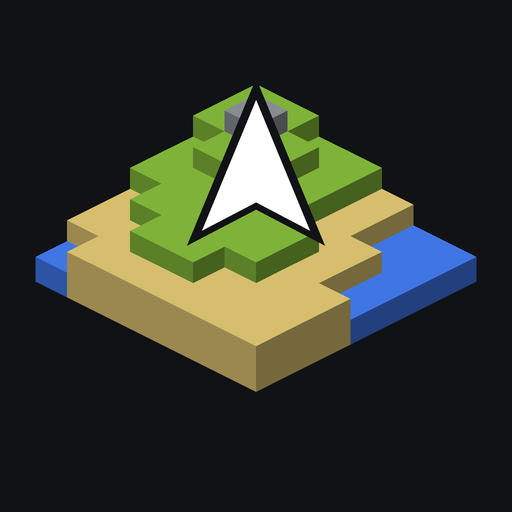
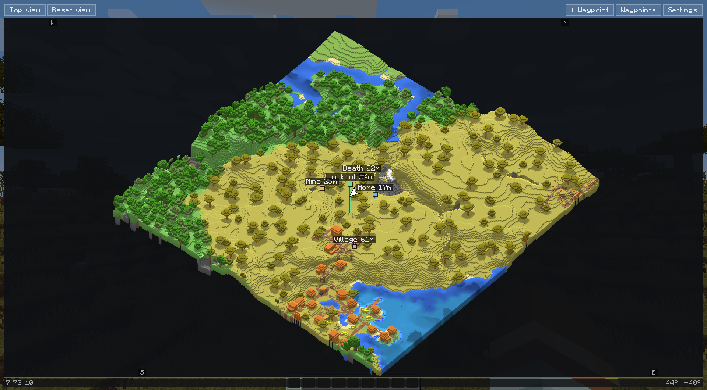
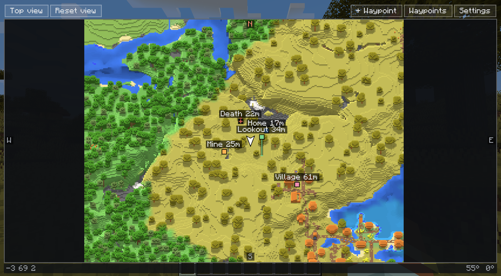
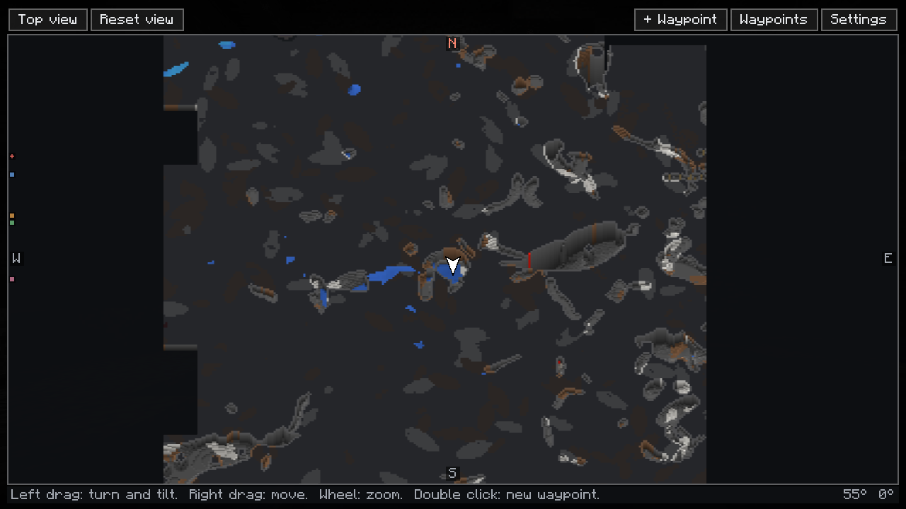
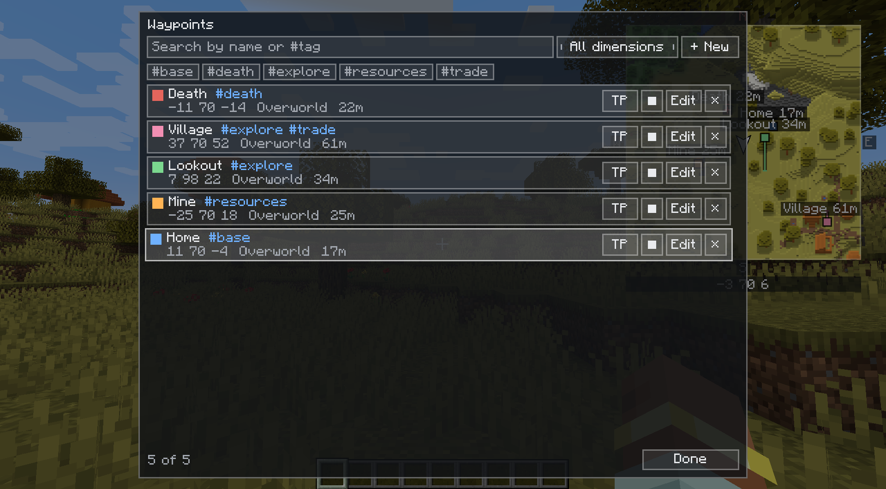

<p align="center"></p>

<h1 align="center">IsoMap</h1>

<p align="center">
A minimalist 2.5D isometric minimap for <b>Minecraft 1.21.1</b>, on <b>NeoForge</b> and <b>Fabric</b>.<br>
<a href="https://modrinth.com/mod/isomap-minimap"></a>
<a href="https://www.curseforge.com/minecraft/mc-mods/isomap"></a>

</p>

<p align="center"><a href="README.ru.md">Читать по-русски</a></p>

Your world as a small isometric model in the corner of the screen: real relief, a free camera, and waypoints that keep their height. Install it on the client and it works on any server; the server only needs the mod for pings to travel between players without chat.



## Features

- **2.5D map:** isometric terrain with biome colours and water depth; tree crowns on real trunks, floating blocks, bridges and overhangs instead of pillars down to the ground. 3D can be turned off for a flat map.
- **Free camera:** turn and tilt with the mouse, from a low angle to straight down.
- **Full-screen map** that remembers explored chunks between sessions. A right click opens a menu: new waypoint here, or teleport there with cheats.
- **Cave view:** underground, the map shows a section of the caves at your height. Works in the Nether.
- **Waypoints** with tags, search (`#tag`), colours, their real height, and teleport with cheats or operator rights. Saved per world and server.
- **Death markers**, created automatically.
- **Pings:** press `G` to put a temporary hologram on whatever you are looking at, visible to other players through walls and on their map.
- **Everything in game:** a settings screen with five tabs and a live preview, soft interface sounds, English and Russian.

| Full map | Cave view | Waypoints |
| --- | --- | --- |
|  |  |  |

## Installation

1. Install NeoForge 21.1.x, or Fabric Loader with [Fabric API](https://modrinth.com/mod/fabric-api), for Minecraft 1.21.1.
2. Download the IsoMap jar for your loader from [Modrinth](https://modrinth.com/mod/isomap-minimap), [CurseForge](https://www.curseforge.com/minecraft/mc-mods/isomap) or [Releases](../../releases) and put it into `mods`.
3. Optional: put the same jar on the server so pings travel invisibly. Players without the mod can still join.

On Fabric the settings are also reachable from [Mod Menu](https://modrinth.com/mod/modmenu), if you have it.

## Default keys

| Key | Action |
| --- | --- |
| `M` | Full map |
| `K` | Settings |
| `J` | Waypoint list |
| `B` | New waypoint here |
| `G` | Ping what you are looking at |
| `N` | Show or hide the minimap |
| `=` / `-` | Zoom |
| Hold `Left Alt` | The mouse turns the map camera, the wheel zooms |
| `Y` | Top-down view |

On the full map: left drag turns, right drag moves, the wheel zooms, a double click creates a waypoint, the middle button pings, a right click opens the menu.

## Building

JDK 21 is needed; Gradle comes with the wrapper.

```bash
./gradlew build
```

The project has three parts: `common` holds the map itself and is compiled against plain Minecraft, so it cannot use either loader by accident; `neoforge` and `fabric` add the thin glue for each loader and compile `common` into their jars. The jars appear in `neoforge/build/libs/` and `fabric/build/libs/`.

`./gradlew :neoforge:runClient` or `:fabric:runClient` starts the game with the mod. `./gradlew :neoforge:runSmokeTest` and `:fabric:runSmokeTest` play through the mod in a real client and write a report to `run-smoke/` and `run-smoke-fabric/`. The technical notes (rendering, assumptions, what is and is not tested) are in the [Russian README](README.ru.md).

## Bug reports and contact

Open an [issue](../../issues/new/choose) or write to **mxlanch0lia@gmail.com**. Please add the Minecraft and IsoMap versions, your other mods and, if the game crashed, the crash report or `logs/latest.log`.

## How it was made

The code, the description and the translations were written by an AI assistant (Claude) under the author's direction. The icon and the sounds were produced by scripts that the assistant wrote (`tools/`), so they are original.

## License

[MIT](LICENSE). The sounds are released into the public domain (CC0).
